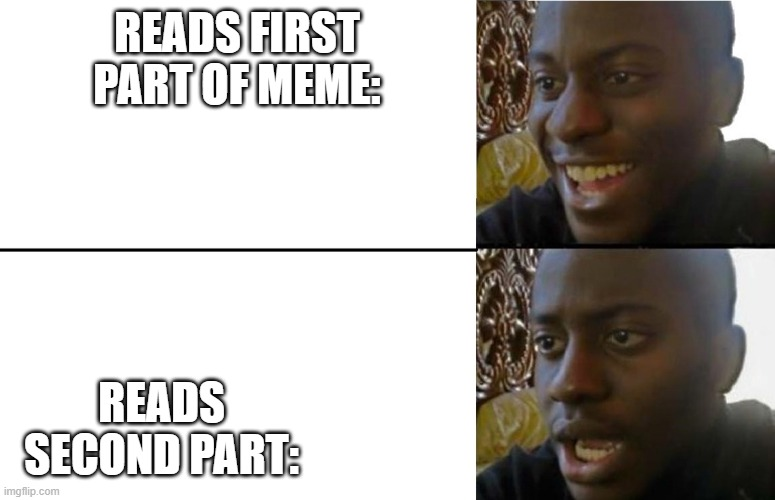

# Sticker Booth — research notes

**Category:** Binary Exploitation  
**Result:** Unsolved

> “A place where you can safely customize your stickers and print them out!”

The service takes a small recipe language: `photo`, `caption`, `builtin`, `mono`, `remove`, `upload`, and `print`. The handout's `recipe_docs.md` is enough to make a normal sheet. The interesting behavior starts where the monochrome filter touches a photo next to another heap object.

## What I confirmed

The `mono` routine processes one row too many and can write 4–64 bytes past the photo into the next sticker allocation. The later solve attempt used duplicate captions to put a refcounted object beside the photo. After `mono` corrupted the count, removing one caption left the other referring to freed storage. A subsequent `builtin b star` reused that memory, and `print` showed the old caption aliasing the new `*` sticker.

The minimal sequence preserved from the remote test is:

```text
photo p 1 2 0000000000000000
caption c 123456789
caption d 123456789
mono p
remove d
builtin b star
print
```

That is evidence of a useful memory corruption path, not yet a flag read. Ordinary builtins only opened the fixed asset files for `heart`, `star`, and `smile`. A path to `/flag` would require more control over the builtin object, and the random `booth_ticket` check prevents a simple path replacement.

## Next step

Reproduce the caption alias locally with the public binary and watch allocator reuse. Then determine whether the overflow can change the builtin's path and satisfy or avoid its ticket check. Only a remote `print` showing the contents of `/flag` would complete this solution. The saved chat has no such output.



## Files

- [Original handout](attachments/handout.zip)
- [Recipe documentation from the handout](evidence/recipe_docs.md)
- [Challenge screenshot](evidence/challenge.png)
